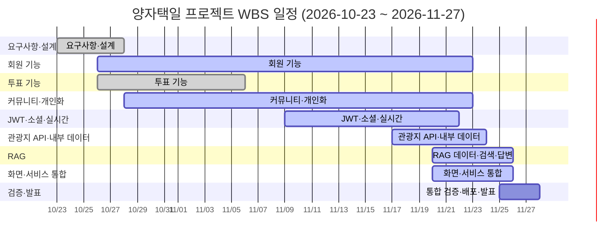

# 양자택일 프로젝트 WBS

> 기간: **2026-10-23 ~ 2026-11-27**  
> 구성: **9개 상위 작업 + 세부 작업**  
> 기준: GitHub 원격 커밋 이력과 프로젝트에서 확인된 기능 범위. 일정·담당 역할은 커밋만으로 확정할 수 없는 부분을 초안으로 표시했다.

## 일정 개요

## 작업 분해 및 추적

| WBS | 상위 작업 패키지 | 작업 항목 | 기간(초안) | 상태(2026-11-20 기준) | 완료 근거·다음 확인 |
|---|---|---|---|---|---|
| 1 | 요구사항·설계 | 상위 작업 | 10/23–10/27 | 완료 | WBS 범위와 설계 자료는 이력으로 재구성. 담당자·세부 산출물은 팀 확인 필요. |
| 1.1 | 요구사항·설계 | 프로젝트 범위·요구사항 정리 | 10/23–10/24 | 자료 확인 필요 | 기존 기획 자료와 실제 구현 범위를 대조해 확정. |
| 1.2 | 요구사항·설계 | DB·ERD 설계 | 10/23–10/27 | 완료 | 스키마 정의 이력 확인: [6d6a587](https://github.com/aranparrk/either-or/commit/6d6a587). ERD·Entity 정합성 확인. |
| 2 | 회원 기능 | 상위 작업 | 10/26–11/22 | 진행 중 | 가입·로그인 기본 기능과 마이페이지 기능이 커밋에 확인됨. 전체 통합 검증 필요. |
| 2.1 | 회원 기능 | 회원가입 | 10/26–10/30 | 완료 | API: [5c501b8](https://github.com/aranparrk/either-or/commit/5c501b8), 화면: [7caf48e](https://github.com/aranparrk/either-or/commit/7caf48e). |
| 2.2 | 회원 기능 | 로그인 | 10/26–11/02 | 완료 | 로그인 API·화면·헤더 연동 커밋 확인: [730cb84](https://github.com/aranparrk/either-or/commit/730cb84), [74df991](https://github.com/aranparrk/either-or/commit/74df991). |
| 2.3 | 회원 기능 | 로그아웃·인증 상태 반영 | 10/28–11/02 | 완료 | 로그아웃 API 및 로그인 상태별 화면 변경 이력 확인. 만료·재로그인 흐름 통합 검증. |
| 2.4 | 회원 기능 | 프로필·회원 정보 수정 및 탈퇴 | 11/15–11/22 | 구현 이력 있음·검증 필요 | 마이페이지·프로필·회원 탈퇴 기능 커밋 확인. 저장 후 재조회와 권한 확인. |
| 3 | 투표 기능 | 상위 작업 | 10/26–11/05 | 완료 | 핵심 투표 CRUD, 참여, 결과, 이미지 흐름이 커밋에 확인됨. |
| 3.1 | 투표 기능 | 투표 등록·선택지 저장 | 10/26–11/01 | 완료 | 등록 기능 이력: [c99ccac](https://github.com/aranparrk/either-or/commit/c99ccac). 필수값·마감일 검증. |
| 3.2 | 투표 기능 | 투표 목록·정렬 조회 | 10/26–11/05 | 완료 | 목록 조회·필터·정렬 커밋 확인. 빈 목록과 정렬 조건 확인. |
| 3.3 | 투표 기능 | 투표 상세 조회 | 10/28–11/02 | 완료 | 상세 조회 이력: [da24e73](https://github.com/aranparrk/either-or/commit/da24e73). 존재하지 않는 ID 처리 확인. |
| 3.4 | 투표 기능 | 투표 수정·삭제 | 10/30–11/13 | 완료 | 수정·삭제 이력: [b48082e](https://github.com/aranparrk/either-or/commit/b48082e). 작성자 권한·참여 기록 조건 확인. |
| 3.5 | 투표 기능 | 투표 참여·선택 변경 | 10/27–11/04 | 완료 | 참여·선택 변경 이력: [e8cda36](https://github.com/aranparrk/either-or/commit/e8cda36), [6371f74](https://github.com/aranparrk/either-or/commit/6371f74). 중복·마감 조건 확인. |
| 3.6 | 투표 기능 | 투표 결과·득표율 조회 | 10/30–11/05 | 완료 | 결과 및 그래프 이력 확인. 마감 전후 공개 조건과 0표 처리 확인. |
| 3.7 | 투표 기능 | 게시글 이미지 업로드 | 11/02–11/05 | 완료 | 이미지 업로드 기능 이력: [e3bd540](https://github.com/aranparrk/either-or/commit/e3bd540). 성공·실패·미첨부 처리 확인. |
| 4 | 커뮤니티·개인화 | 상위 작업 | 10/28–11/22 | 진행 중 | 댓글·즐겨찾기·마이페이지 기능 이력 확인. 각 사용자 데이터 및 권한 통합 검증 필요. |
| 4.1 | 커뮤니티·개인화 | 댓글 등록·목록 조회 | 10/28–10/30 | 완료 | 댓글 기능 이력: [51c84e6](https://github.com/aranparrk/either-or/commit/51c84e6). |
| 4.2 | 커뮤니티·개인화 | 댓글 수정·삭제 | 11/10–11/13 | 완료 | 댓글 수정·삭제 이력: [af06e21](https://github.com/aranparrk/either-or/commit/af06e21). 비작성자 권한 확인. |
| 4.3 | 커뮤니티·개인화 | 즐겨찾기 추가·해제 | 11/18–11/20 | 완료 | 즐겨찾기 이력: [8e76a98](https://github.com/aranparrk/either-or/commit/8e76a98). 중복 추가·해제 후 상태 확인. |
| 4.4 | 커뮤니티·개인화 | 마이페이지 조회 | 11/13–11/20 | 구현 이력 있음·검증 필요 | 내 투표·댓글·즐겨찾기 조회 관련 이력 확인. 사용자별 목록 분리 확인. |
| 4.5 | 커뮤니티·개인화 | 회원 탈퇴 | 11/18–11/20 | 구현 이력 있음·검증 필요 | 탈퇴 API·화면 이력 확인. 재로그인 차단과 연관 데이터 처리 확인. |
| 5 | JWT·소셜 로그인·실시간 기능 | 상위 작업 | 11/09–11/21 | 진행 중 | 기능 구현 커밋은 있으나 통합 시나리오와 과제의 실시간 요구 범위를 확인해야 함. |
| 5.1 | JWT·소셜 로그인·실시간 기능 | JWT Access·Refresh 발급·재발급 | 11/09–11/17 | 구현 이력 있음·통합 확인 필요 | 전환 이력 [4688620](https://github.com/aranparrk/either-or/commit/4688620), Refresh Token [8b7de3a](https://github.com/aranparrk/either-or/commit/8b7de3a). 만료·재발급·보호 API 확인. |
| 5.2 | JWT·소셜 로그인·실시간 기능 | 카카오·구글 로그인·회원가입 | 11/16–11/21 | 구현 이력 있음·흐름 확인 필요 | 카카오 [007d118](https://github.com/aranparrk/either-or/commit/007d118), 구글 [0e8b7d5](https://github.com/aranparrk/either-or/commit/0e8b7d5). 신규·기존·취소 흐름 검증. |
| 5.3 | JWT·소셜 로그인·실시간 기능 | WebSocket/STOMP 댓글 실시간 알림 | 11/10–11/17 | 구현 이력 있음·검증 필요 | 댓글 실시간 이력 [6a9f8a0](https://github.com/aranparrk/either-or/commit/6a9f8a0). 실제 채팅방·메시지 요구 충족 여부 팀 결정. |
| 6 | 관광지 API·내부 투표 데이터 연결 | 상위 작업 | 11/17–11/23 | 진행 중 | 외부 관광 데이터와 내부 투표 집계 연결. 커밋된 내용과 로컬 변경을 구분해 확인. |
| 6.1 | 관광지 API·내부 투표 데이터 연결 | 관광지 키워드 검색 API | 11/17–11/21 | 커밋 확인·검증 필요 | 외부 API 연동 이력: [b9d9cdc](https://github.com/aranparrk/either-or/commit/b9d9cdc). 빈 결과·외부 오류 확인. |
| 6.2 | 관광지 API·내부 투표 데이터 연결 | 관광지 상세 API | 11/18–11/21 | 원격 커밋 확인 필요 | 상세 정보 DTO·주소·소개·이미지 응답 확인. 현재 작업 트리의 미커밋 변경은 이력으로 확정하지 않음. |
| 6.3 | 관광지 API·내부 투표 데이터 연결 | 관광지 정보를 투표 선택지와 연결 | 11/18–11/22 | 구현 흐름 확인 필요 | contentId·이미지가 등록·조회·수정에서 유지되는지 확인. |
| 6.4 | 관광지 API·내부 투표 데이터 연결 | 주간 인기 여행지 집계 | 11/18–11/23 | 완료 이력·범위 명시 필요 | 주간 집계 이력: [a736c82](https://github.com/aranparrk/either-or/commit/a736c82). contentId가 없는 자유 입력 투표는 집계 대상에서 빠지는 점 표시. |
| 7 | RAG 데이터·검색·답변 | 상위 작업 | 11/20–11/25 | 진행 중 | 현재 원격 커밋은 AI 서비스 초기 구조까지 확인됨. 나머지 단계는 예정 작업. |
| 7.1 | RAG 데이터·검색·답변 | 내부·외부 데이터 범위와 질문 유형 정의 | 11/20–11/21 | 결정 필요 | 내부 DB 자료와 외부 관광 정보를 구분하고 대표 질문·근거 범위 확정. |
| 7.2 | RAG 데이터·검색·답변 | 자료 문서화·청킹·적재 | 11/20–11/23 | 일부 초기 코드 확인 | 현재 확인된 범위는 health·chunk preview·split_text 초기 구조. 실제 자료 적재 여부 확인. |
| 7.3 | RAG 데이터·검색·답변 | 임베딩 생성·벡터 저장 | 11/21–11/24 | 예정 | 임베딩 모델과 벡터 저장소를 정하고 적재·갱신 경로 구현. |
| 7.4 | RAG 데이터·검색·답변 | 질문 기반 관련 자료 검색 | 11/22–11/24 | 예정 | 검색 API와 관련 청크 반환, 근거 품질 확인. |
| 7.5 | RAG 데이터·검색·답변 | 검색 근거 기반 답변 생성 | 11/22–11/25 | 예정 | LLM 요청·응답 형식, 출처 반환, 오류 처리 구현. |
| 8 | 화면·서비스 통합 | 상위 작업 | 11/20–11/25 | 진행 중 | React·Spring Boot·AI 서비스 요청과 응답을 연결. |
| 8.1 | 화면·서비스 통합 | 관광지 검색·선택 화면 | 11/20–11/22 | 구현 확인 필요 | 검색·선택·취소·실패 상태를 화면에서 확인. |
| 8.2 | 화면·서비스 통합 | 여행 AI 도우미 화면 | 11/23–11/25 | 예정 | 질문 입력, 답변·출처·로딩·오류 상태 표시. |
| 8.3 | 화면·서비스 통합 | Spring Boot–AI 서비스 연결 | 11/22–11/25 | 예정 | API 호출·응답 매핑·시간 초과·공통 오류 처리. |
| 9 | 통합 검증·배포·발표 | 상위 작업 | 11/25–11/27 | 예정 | 기능 검증, 배포 범위 결정, 발표 시나리오 준비. |
| 9.1 | 통합 검증·배포·발표 | 회원·투표·관광지·RAG 통합 검증 | 11/25–11/26 | 예정 | 정상·실패 시나리오와 수정 내역 기록. |
| 9.2 | 통합 검증·배포·발표 | 배포 여부 결정 및 환경 설정 | 11/25–11/26 | 선택 | 배포 요구와 남은 시간에 따라 진행 범위 결정. |
| 9.3 | 통합 검증·배포·발표 | 발표 자료·시연 준비 | 11/26–11/27 | 예정 | 여행지 선택→내부 투표 집계→RAG 답변 시연 흐름 확정. |

## 상태 판단 기준

- **완료**: 해당 기능의 원격 커밋 이력이 확인됨. 발표 전 통합 시나리오 검증은 별도로 남을 수 있음.
- **구현 이력 있음·검증 필요**: 관련 커밋은 있으나 현재 통합·예외 흐름까지 확인되지 않음.
- **예정 / 결정 필요 / 선택**: 원격 커밋에서 완료 근거가 확인되지 않았거나 팀 의사결정이 필요한 작업.
- 커밋 작성자는 실제 담당자로 단정하지 않았다. 담당자는 팀에서 배정해야 한다.
- 로컬 작업 트리에만 있는 미커밋 코드는 완료 근거로 세지 않았다.

## 커밋 이력 기준점

- 2026-10-26: DB 스키마·JPA 설정 및 기본 엔티티
- 2026-10-27~11-05: 회원·투표·댓글 기본 기능, 목록·결과·이미지
- 2026-11-09~11-17: JWT/Refresh Token, 소셜 로그인, 실시간 댓글, 마이페이지
- 2026-11-18~11-20: 관광 API, 주간 랭킹, 즐겨찾기, RAG 서비스 초기 구조

## 팀에서 확정할 항목

1. 세부 작업별 실제 담당자와 완료일
2. STOMP 댓글 알림이 과제의 채팅 요구를 충족하는지
3. 내부 데이터와 외부 관광 데이터의 RAG 검색 범위
4. 배포 여부와 발표 시연에 포함할 기능
